# M4 blended look (#131): every screen outside battle

The owner's pick from the three bold directions (`../m4-bold/`, answers in
`docs/decisions/2026-10-28-m4-review-answers.md`): **C's structure, A's readability, B's shine,
light and dark.** This is the app, not a mockup. Wording and element order are unchanged.

| Screen | Light | Dark |
|---|---|---|
| Home | 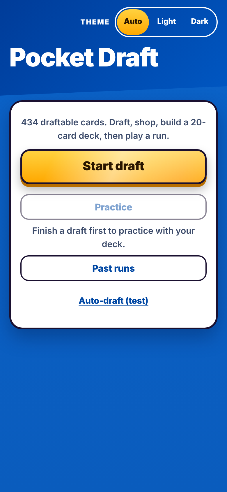 | 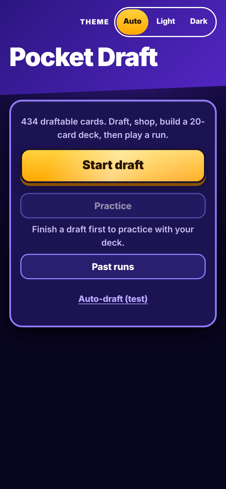 |
| Draft | 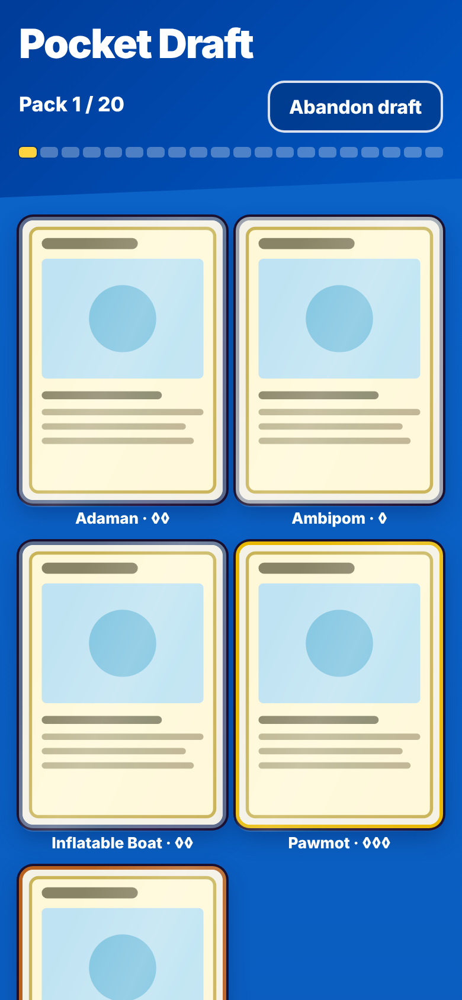 | 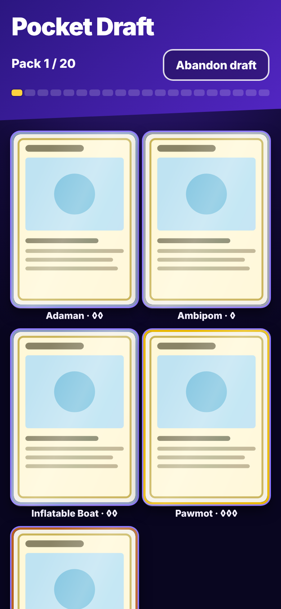 |
| Shop | 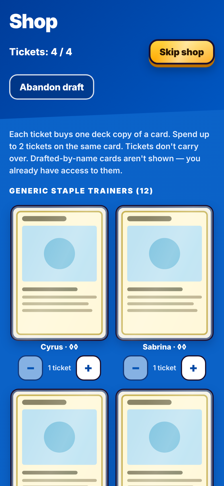 | 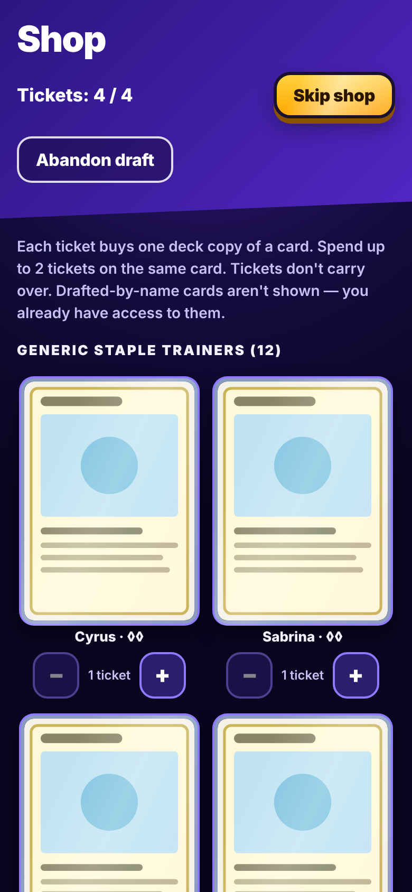 |
| Deckbuild | 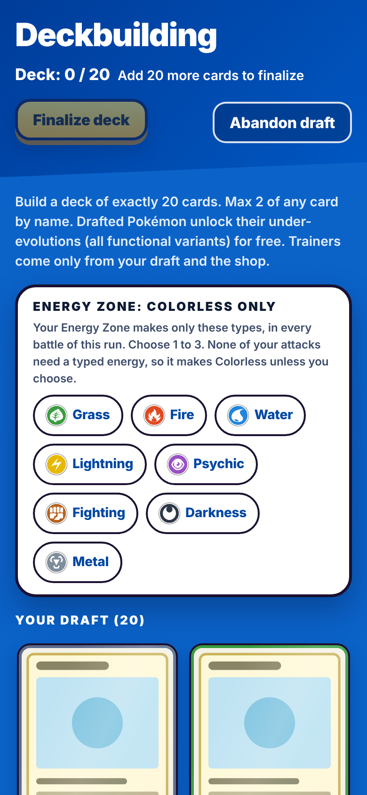 | 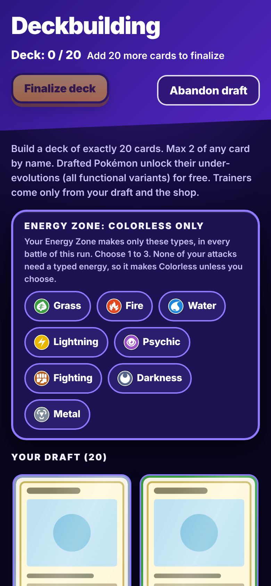 |
| Run screen | 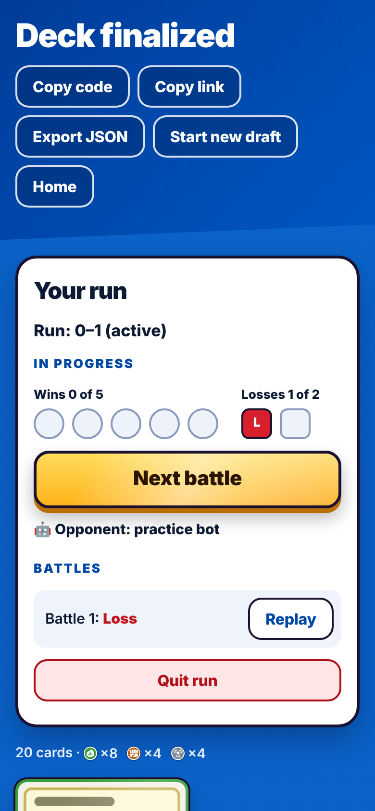 | 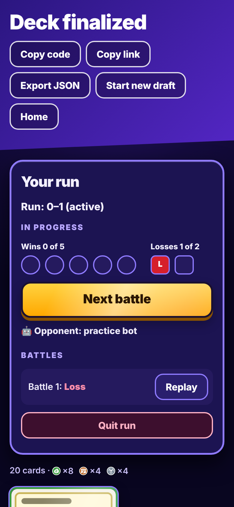 |
| End of run (quit) | 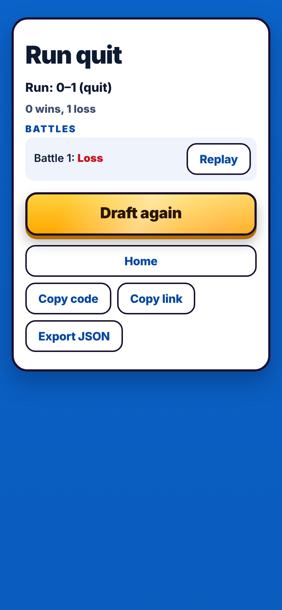 | 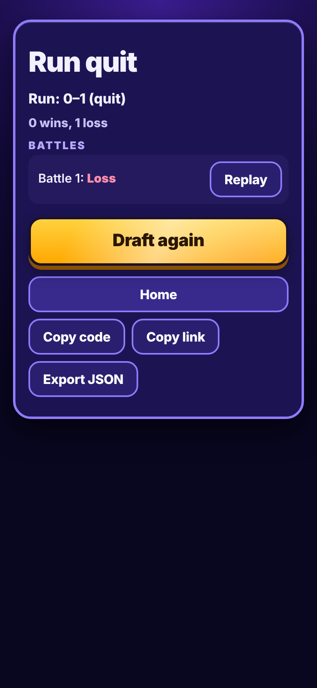 |
| End of run (won) | 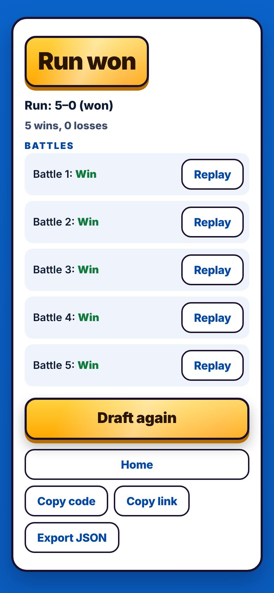 | 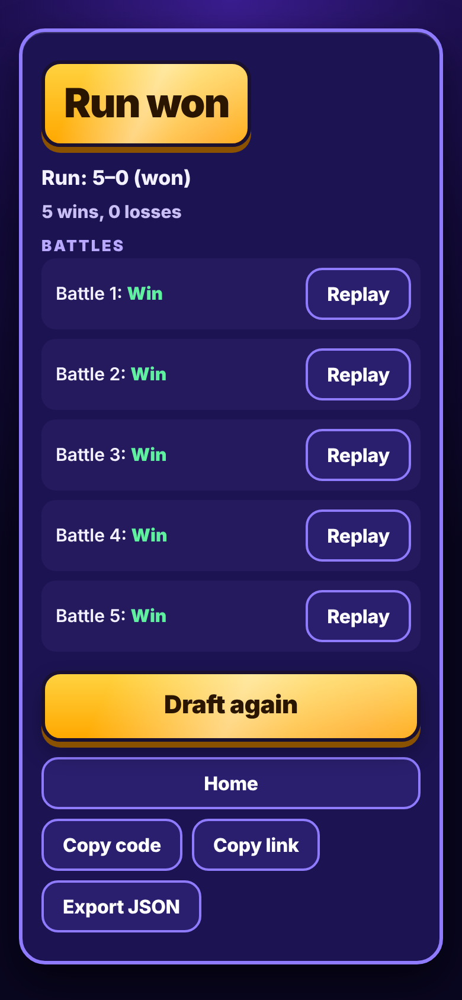 |
| Past runs | 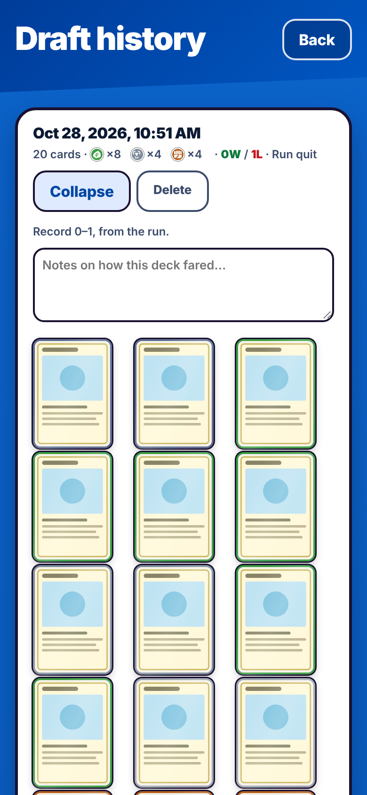 | 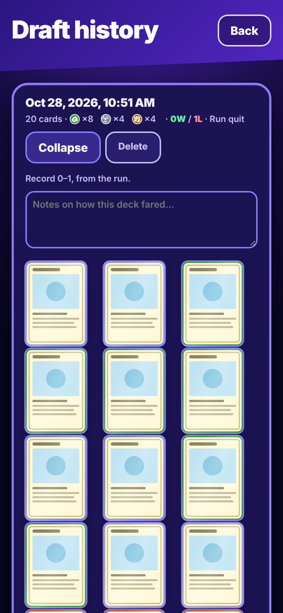 |

Regenerate from the repo root (starts the Go server and Vite dev server, like the e2e suite):

```sh
npx playwright test -c docs/chief/look/m4-blend/render.config.ts
node docs/chief/look/m4-blend/contrast.cjs --md     # the table below
```

The light pass drives the real app (20 picks, skip shop, build, one conceded battle, quit) and keeps
localStorage at each screen; the dark pass seeds those copies. Card art can't load in the cloud
sandbox, so every card is the same placeholder face. Screenshots use reduced motion, so the holo
sheen shows as its still glint.

## What each direction gave

- **C · Type Colour (structure):** blue page, a slanted header band behind each screen's title and
  actions, white 22px-radius panels with deep soft shadows, the gold "3D" main button (5px base it
  presses into), 20-segment pack progress on the draft, round win / square loss marks, the battles
  list as soft rows, Quit run as a soft red button.
- **A · Pack Burst (readability):** 900-weight tight-tracked titles (34px screens, 44px Home),
  800-weight buttons, 600-weight body; 3px ink outlines on panels and the main button, 2px on buttons,
  chips and card frames. No sunburst, no italic caps, no hard offset shadows.
- **B · Holo Night (shine + dark):** a diagonal foil sheen on every card tile, the main button and a
  won run's title plate; stronger on a hovered, focused or selected (bought / in deck) card. It sweeps
  once every 6 s; with `prefers-reduced-motion: reduce` it is a still glint. The dark theme is B's
  indigo night with C's structure.

## Theme

- Default **Auto** follows the phone (`prefers-color-scheme`). The Home header has a **Theme:
  Auto / Light / Dark** toggle (`src/components/ThemeToggle.tsx`, self-contained, can move anywhere).
- The choice is saved in localStorage `pocket-draft-theme` (guarded; Auto removes it) and applied as
  `data-theme` on `<html>` before the first paint (`src/theme.ts`).
- `src/tokens.css` holds each dark set twice: under `@media (prefers-color-scheme: dark)` guarded by
  `:root:not([data-theme="light"])`, and under `:root[data-theme="dark"]`.

## Tokens (`src/tokens.css`, `--look-*`)

| Group | Light | Dark |
|---|---|---|
| Page | `--look-page` `#0b63c9` (gradient to `#0a5cbd`), text `#fff` / muted `#e3eeff` | `#140b3d`, radial `#3a1d8f → #140b3d → #090620`, text `#f3f0ff` / muted `#c9bff5` |
| Header band | `--look-band` `#003c99 → #0057c2`, slanted 16px (`--look-band-slant`) | `#2b1680 → #5326c4` |
| Panel | `--look-panel` `#fff`, rows `#eef3fc`, ink `#0d1a33`, muted `#3d4c6b`, labels `#0047a3` | `#1c1452`, rows `#251a5e`, ink `#f3f0ff`, labels `#b9a8ff` |
| Outline | `--look-outline` `#1a1030`, 3px panels / cards, 2px buttons | rim `#8f7bff` |
| Main button | `--look-gold` `#ffd23f → #ffa800`, text `#2a1600`, base `#b86e00` | same gold, base `#8a5200` |
| Danger | soft `#ffe5e5` / `#b0101a`; fill `#d61f2b` / `#fff` | soft `#3d0f2e` / `#ffb3c5` |
| Results | win `#0b7d3b` (word `#0e7a3c`), loss `#d61f2b` (word `#c4141c`) | words `#5ff0a0` / `#ff8fab` |
| Shape | panels 22px, buttons 14px, main button 16px, cards 12px | same |
| Shadow | panel `0 14px 32px rgba(0,30,80,.38)`, card `0 8px 18px …` | deeper black, violet glow on hot cards |
| Type | display 900 / strong 800 / body 600; 34 title, 24 panel title, 21 main button, 16 body, 13 caps labels (+0.12em) | same |
| Focus ring | white on page, gold on band, ink on panel | gold everywhere |
| Sheen | `--look-sheen` 115° white/cyan/pink foil, `screen` blend, rest 0.3, hot 0.85, period 6 s | rest 0.4 |

The battle board is not restyled: it keeps reading the legacy `--color-*` set, whose values did not
change. `src/look.css` applies the blend only inside `.look`, the root of every screen except the
battle board and its replay.

## Contrast (WCAG 2, from `contrast.cjs`)

| Theme | Pair | Colours | Ratio | Needs |
|---|---|---|---|---|
| light | Body text on panel | `#0d1a33` on `#ffffff` | 17.32:1 | 4.5:1 pass |
| light | Muted text on panel | `#3d4c6b` on `#ffffff` | 8.59:1 | 4.5:1 pass |
| light | Muted text on inner row | `#3d4c6b` on `#eef3fc` | 7.72:1 | 4.5:1 pass |
| light | Section label / button text on panel | `#0047a3` on `#ffffff` | 8.64:1 | 4.5:1 pass |
| light | Button text on button hover | `#0047a3` on `#dfeaff` | 7.14:1 | 4.5:1 pass |
| light | Text on page blue | `#ffffff` on `#0b63c9` | 5.77:1 | 4.5:1 pass |
| light | Muted text on page blue | `#e3eeff` on `#0b63c9` | 4.93:1 | 4.5:1 pass |
| light | Text on header band (dark end) | `#ffffff` on `#003c99` | 9.97:1 | 4.5:1 pass |
| light | Text on header band (light end) | `#ffffff` on `#0057c2` | 6.68:1 | 4.5:1 pass |
| light | Main button text on gold (top) | `#2a1600` on `#ffd23f` | 11.99:1 | 4.5:1 pass |
| light | Main button text on gold (bottom) | `#2a1600` on `#ffa800` | 8.95:1 | 4.5:1 pass |
| light | Quit run text on soft red | `#b0101a` on `#ffe5e5` | 5.99:1 | 4.5:1 pass |
| light | Win mark letter on green | `#ffffff` on `#0b7d3b` | 5.24:1 | 4.5:1 pass |
| light | Loss mark letter on red | `#ffffff` on `#d61f2b` | 5.13:1 | 4.5:1 pass |
| light | Loss word on inner row | `#c4141c` on `#eef3fc` | 5.44:1 | 4.5:1 pass |
| light | Win word on panel | `#0e7a3c` on `#ffffff` | 5.43:1 | 4.5:1 pass |
| light | Outline ink on page blue (UI) | `#1a1030` on `#0b63c9` | 3.14:1 | 3:1 pass |
| light | Focus ring on page (white) | `#ffffff` on `#0b63c9` | 5.77:1 | 3:1 pass |
| light | Focus ring on band (gold) | `#ffd23f` on `#0057c2` | 4.63:1 | 3:1 pass |
| light | Focus ring on panel (ink) | `#1a1030` on `#ffffff` | 18.09:1 | 3:1 pass |
| light | Theme toggle: chosen option on gold | `#2a1600` on `#ffd23f` | 11.99:1 | 4.5:1 pass |
| light | Theme toggle: other options on band | `#ffffff` on `#003c99` | 9.97:1 | 4.5:1 pass |
| light | Pack segment (gold) on band (UI) | `#ffd23f` on `#0057c2` | 4.63:1 | 3:1 pass |
| dark | Body text on panel | `#f3f0ff` on `#1c1452` | 14.72:1 | 4.5:1 pass |
| dark | Body text on page | `#f3f0ff` on `#140b3d` | 16.35:1 | 4.5:1 pass |
| dark | Muted text on panel | `#c9bff5` on `#1c1452` | 9.64:1 | 4.5:1 pass |
| dark | Muted text on page (darkest) | `#c9bff5` on `#090620` | 11.58:1 | 4.5:1 pass |
| dark | Section label on panel | `#b9a8ff` on `#1c1452` | 7.95:1 | 4.5:1 pass |
| dark | Text on inner row | `#f3f0ff` on `#251a5e` | 13.49:1 | 4.5:1 pass |
| dark | Text on header band (dark end) | `#ffffff` on `#2b1680` | 13.73:1 | 4.5:1 pass |
| dark | Text on header band (light end) | `#ffffff` on `#5326c4` | 8.60:1 | 4.5:1 pass |
| dark | Button text on button | `#ffffff` on `#2a1f6e` | 13.82:1 | 4.5:1 pass |
| dark | Main button text on gold (bottom) | `#2a1600` on `#ffa800` | 8.95:1 | 4.5:1 pass |
| dark | Quit run text on soft red | `#ffb3c5` on `#3d0f2e` | 9.57:1 | 4.5:1 pass |
| dark | Loss word on inner row | `#ff8fab` on `#251a5e` | 7.04:1 | 4.5:1 pass |
| dark | Win word on panel | `#5ff0a0` on `#1c1452` | 11.37:1 | 4.5:1 pass |
| dark | Win mark letter on green | `#ffffff` on `#0b7d3b` | 5.24:1 | 4.5:1 pass |
| dark | Loss mark letter on red | `#ffffff` on `#d61f2b` | 5.13:1 | 4.5:1 pass |
| dark | Outline rim on page (UI) | `#8f7bff` on `#140b3d` | 5.63:1 | 3:1 pass |
| dark | Focus ring (gold) on panel | `#ffd23f` on `#1c1452` | 11.44:1 | 3:1 pass |
| dark | Focus ring (gold) on page | `#ffd23f` on `#090620` | 13.74:1 | 3:1 pass |

Disabled controls (opacity 0.5, e.g. Finalize deck before 20 cards) are exempt from WCAG contrast and
are not in the table.
