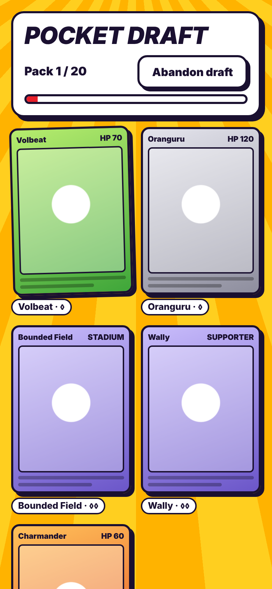
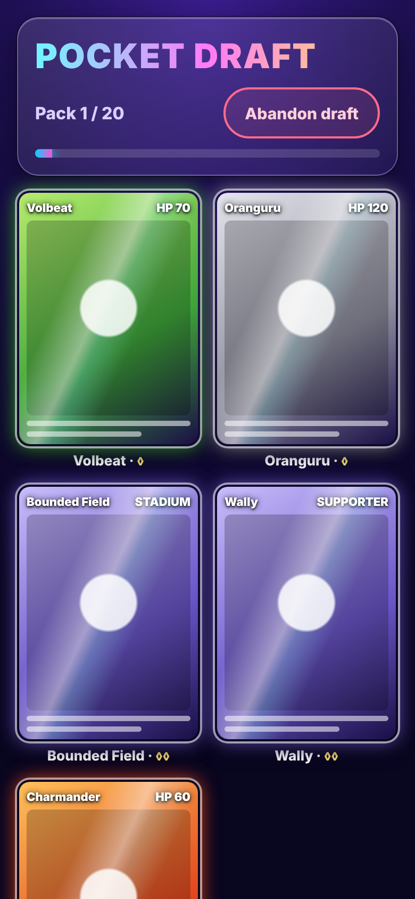
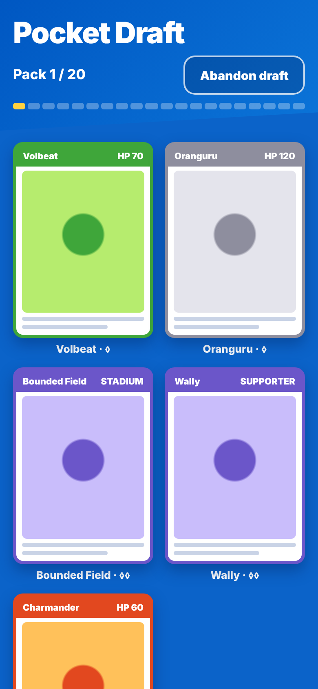
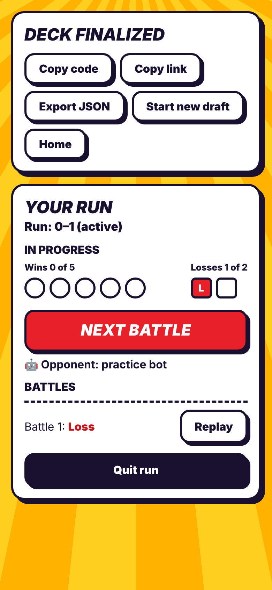
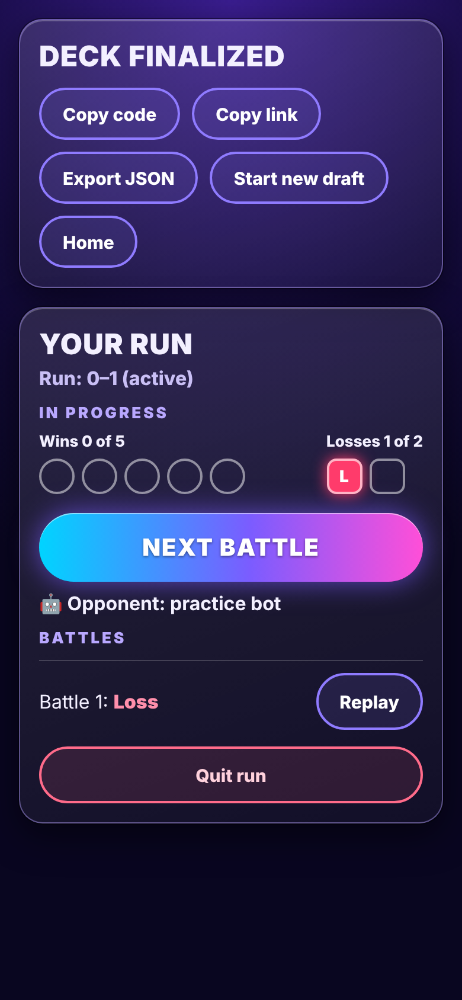
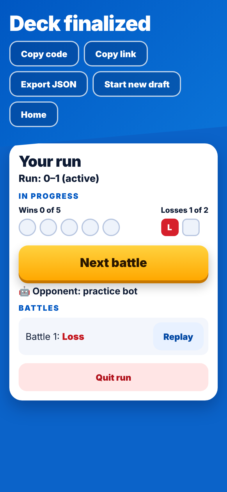

# M4 bold look: three directions to pick from (issue #131)

From the 2026-10-27 play-test: the screens outside battle need to be much bolder.
These are **mockups, not the app**. Nothing in `src/` changed. Each one redraws the
real draft screen and run screen at 390×844 with the **same wording and the same
order** as today. Only the look differs.

Card art can't load in the cloud sandbox, so cards are stand-ins: a type-coloured
frame with name and HP. In the app, the real card image sits inside the frame.

`overview.png` shows all six side by side. Regenerate with
`node docs/chief/look/m4-bold/render.cjs`. Open `mockup.html?dir=burst|holo|type&screen=draft|run`
to see one live.

| | A · Pack Burst | B · Holo Night | C · Type Colour |
|---|---|---|---|
| Draft |  |  |  |
| Run |  |  |  |

## A · Pack Burst
The feel of tearing open a pack: loud, comic-book, very readable in sunlight.
- **Palette:** a yellow/orange sunburst background, ink-navy `#1a1030` outlines, red `#e8202a` for the main action, green wins, red losses.
- **Type scale:** 34 px heavy italic all-caps titles, 22 px italic caps on the main button, 16–17 px heavy body.
- **Surfaces:** white panels with 3 px ink borders and hard 6 px offset shadows (no blur). Cards get the same outline and a slight tilt on the highlighted offer.
- **Motion:** buttons drop into their shadow on press (translate 4 px). A picked card spins and flies off. The sunburst rotates slowly on Home only.
- **Contrast:** ink on yellow 10:1. White on the red button 4.5:1. White on ink 18:1.

## B · Holo Night
The foil-card moment: dark, glowing, premium. Closest to Pocket's pack-opening screen.
- **Palette:** an indigo-to-black radial background, a cyan → violet → magenta foil gradient on the title and main button, neon green wins, hot-pink losses.
- **Type scale:** 32 px heavy caps titles in foil gradient text, 13 px letter-spaced caps section labels, 20 px caps on the main button.
- **Surfaces:** translucent glass panels with a light rim. Cards glow in their type colour and carry a diagonal holo sheen.
- **Motion:** the sheen follows tilt or drag across a card. The main button breathes its glow. A picked card bursts into sparkles.
- **Contrast:** body text 16:1 and labels 8.8:1 on the background. The main button's white text is 4.4:1 at its centre and only passes as large bold text: keep it 20 px+ and bold.
- **Dark only:** light mode would be a separate design.

## C · Type Colour
Pocket's clean white cards, made bold with full-bleed colour blocks. The safest step from today.
- **Palette:** a strong blue `#0057c2`→`#0b74d8` slanted header band over a blue page, white content panels, and a gold `#ffd23f`→`#ffa800` main button. The band could take the colour of your deck's lead type: Fire red, Grass green, and so on.
- **Type scale:** 36 px heavy tight-tracked titles, 13 px letter-spaced caps section labels in blue, 21 px on the main button.
- **Surfaces:** white 22 px-radius panels with deep soft shadows. Cards have a solid type-colour header bar and a 4 px frame. Pack progress is 20 segments.
- **Motion:** the main button has a 5 px "3D" base it presses into. Segments fill on each pick. The header band slides in.
- **Contrast:** white on the header band 4.7:1 or better. Ink on gold 8.9:1. Blue on light buttons 7.6:1.

## What happens after the pick
The chosen direction (or a mix, e.g. "C's layout with A's outlines") goes into
`src/tokens.css` and the shared components. Then every non-battle screen gets fresh
390×844 screenshots, in light and dark if the direction has both.
